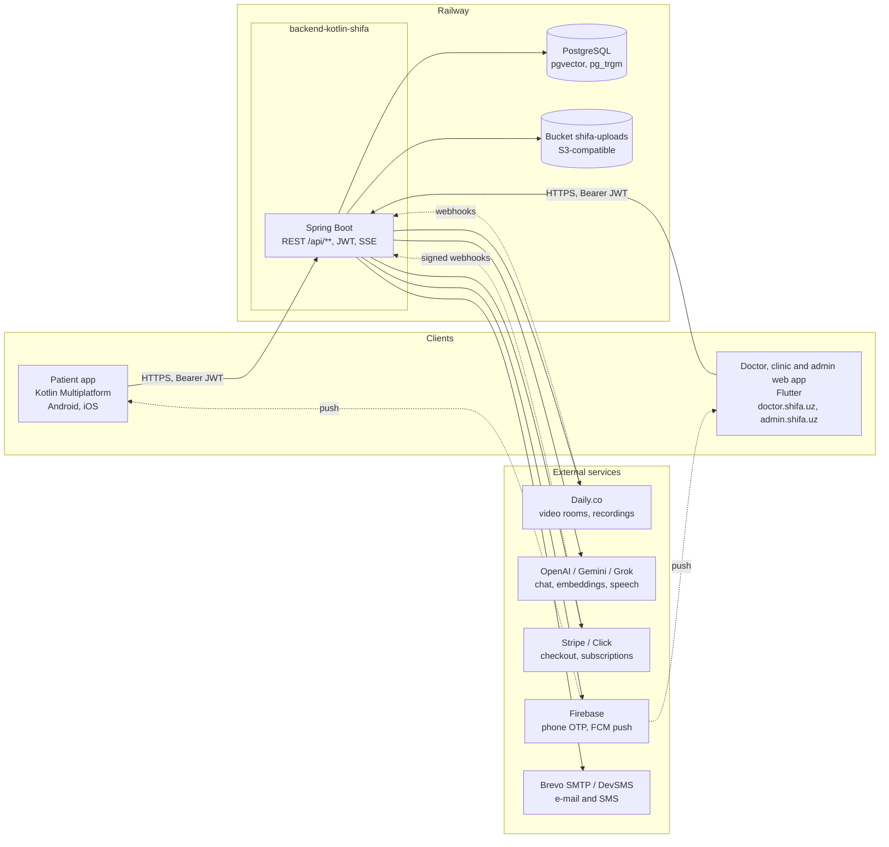
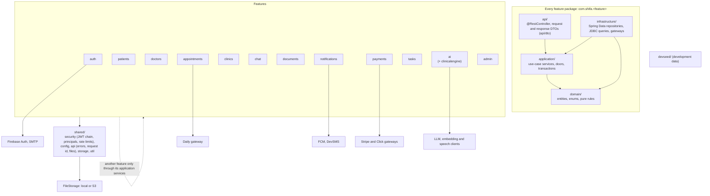

# Shifa Backend

Medical platform backend for the Shifa patient app (Kotlin Multiplatform) and the Shifa doctor, clinic and admin web app
(Flutter). Kotlin + Spring Boot, PostgreSQL, deployed on Railway. One REST API under `/api/` is the only contract between
the apps and the backend; `docs/api/openapi.json` is its committed snapshot.

The re-architecture plan, its status and the release procedure are in `docs/ARCHITECTURE_ROADMAP.md`. The rules for
working in this repository are in `CLAUDE.md`.

## Tech stack

| Layer | Technology |
|-------|-----------|
| Language | Kotlin 2.4.21 / Java 21 |
| Framework | Spring Boot 4.1.2 (Spring Security 7, Spring Data JPA, Actuator) |
| Database | PostgreSQL (16 locally, 17 on Railway) with `pgvector` (clinical RAG) and `pg_trgm` (ICD-10 search) |
| Migrations | Flyway, 122 migrations in `src/main/resources/db/migration/` (`V1` to `V122`) |
| Auth | JWT (JJWT) bound to a server-side session (`jti`), Firebase phone OTP, e-mail and SMS OTP, BCrypt |
| AI | OpenAI, Gemini and Grok behind one `LlmProviderRegistry`; OpenAI embeddings for RAG; Whisper and Gemini speech; PDFBox |
| Video | Daily.co rooms, tokens and recording webhooks |
| Payments | Stripe (subscriptions, Connect) and Click, both with signed webhooks |
| Push and SMS | Firebase Cloud Messaging, DevSMS |
| E-mail | Brevo SMTP |
| Caching | Caffeine (`icd10Search`, `professions`, `publicClinics`, `publicDoctor`, session validity, rate-limit buckets) |
| Rate limiting | Bucket4j, per IP and per user; separate daily and burst limits for `/api/ai/**` |
| Job locking | ShedLock on every scheduled job that changes data |
| Storage | `shared/storage/FileStorage`: local directory or S3-compatible Railway bucket |
| API docs | springdoc-openapi 2.8.17 (Swagger UI in the local and development profiles) |
| Quality | detekt with a baseline, JaCoCo, ArchUnit architecture tests, OpenAPI snapshot test |
| Build | Gradle 8.14.3 (Kotlin DSL), output `build/libs/app.jar`, Dockerfile for Railway |

## Prerequisites

- **Java 21** (or let the Gradle toolchain download it)
- **Docker** for the local PostgreSQL, or a local PostgreSQL 16+ with `pgvector` on port 5433
- **Git**

## Getting started

### 1. Clone and configure

```bash
git clone <repo-url>
cd backend-kotlin-shifa
```

Copy `src/main/resources/application-local.example.yml` to `application-local.yml` (git-ignored) in the same folder
and fill in the keys you need. Everything left empty stays off or logs instead (OTP codes, SMS, AI). Firebase
(phone OTP, push) reads the `FIREBASE_SERVICE_ACCOUNT_JSON` environment variable directly.

### 2. Start the database

```bash
docker-compose up -d
```

PostgreSQL listens on port **5433** (not 5432, to avoid clashing with a local install). Database, user and password are
all `shifa`.

### 3. Run

```bash
./gradlew bootRun
```

Flyway applies every migration at startup. With `app.dev-seed: true` (the default in the local example and on the
development environment) the database gets deterministic test data: three doctors (`seed.doctor1@shifa.dev`, password
`Dev12345!`), patients, a clinic with staff, appointments in every status, documents, tasks and notifications.

### 4. Verify

- Health: `http://localhost:8080/actuator/health` (`/liveness` and `/readiness` groups)
- Build info: `http://localhost:8080/actuator/info`
- Admin health page: `http://localhost:8080/admin-metrics/` (admin sign-in with the e-mailed code; polls `GET /api/admin/metrics`: build, JVM, database, record counts and request counters)
- Swagger UI: `http://localhost:8080/swagger-ui/index.html`
- OpenAPI: `http://localhost:8080/v3/api-docs`

## Common commands

```bash
docker-compose up -d                 # local PostgreSQL on 5433
./gradlew bootRun                    # run with the local profile
./gradlew test                       # all tests (needs the database for the context test)
./gradlew detekt                     # static analysis against config/detekt/baseline.xml
./gradlew build                      # compile, detekt, tests, JaCoCo, jar
./gradlew test --tests com.shifa.ArchitectureTest        # ArchUnit rules only
./gradlew test --tests com.shifa.ApplicationContextTest  # context, migrations, OpenAPI snapshot
java -jar build/libs/app.jar         # run the built jar
```

## System architecture



Two Railway environments run the same code: **development** (`https://api-dev.shifa.uz`, deploys every merge to `main`,
profile `prod,dev`, seeded test data) and **production** (`https://api.shifa.uz` and the original
`shifa-doc-backend-mvp-production.up.railway.app` host, deploys the `production` branch, moved only by the
"Release to production" workflow). Each environment has its own PostgreSQL and bucket.

## Backend architecture

The code is a **modular monolith**: one package per feature, four layers inside each, under `src/main/kotlin/com/shifa/`.



| Feature | Files | What it owns |
|---------|------:|--------------|
| `admin/` | 20 | Admin panel API, admin profiles, audit log, system config, deleted-patient export |
| `ai/` | 109 | Doctor AI and morning assistant, patient co-pilot, briefings, scribe, transcription, clinical RAG, ICD-10, LLM routing and clients, intelligence memory, speech, `clinicalengine/` (its own four layers) |
| `appointments/` | 74 | Booking, calendar, schedule rules, blocks and validity periods, visits, consultation notes, video (Daily), appointment intelligence, visit facts |
| `auth/` | 39 | Login, registration, OTP (SMS and e-mail), sessions, users and roles, account deletion |
| `chat/` | 12 | Conversations, messages, attachments |
| `clinics/` | 65 | Clinics, memberships, invitations, finance ledger and audit, treatment plans, installments, visit charges |
| `devseed/` | 1 | Deterministic development data (`app.dev-seed`) |
| `doctors/` | 58 | Doctor profiles, services and prices, locations, reviews, analytics, professions, public directory |
| `documents/` | 15 | Patient documents, access grants and requests, document storage |
| `notifications/` | 20 | Notification feed, FCM push, SMS, reminder jobs, SMS billing |
| `patients/` | 34 | Patient profiles, forms, prophylaxis, care partnerships, doctor-patient access, `CurrentPatientResolver` |
| `payments/` | 38 | Checkout, gateways (Click, Stripe, manual), webhooks, subscriptions and tiers, doctor billing |
| `shared/` | 54 | Security filter chain and principals, config, error handling, request id, file serving, storage, `PublicUrls`, upload policy |
| `tasks/` | 8 | Remote-care tasks and check-ins |

Counts drift as features land; regenerate with `find src/main/kotlin/com/shifa/<feature> -name '*.kt' | wc -l`.

### Rules, enforced by `ArchitectureTest` (ArchUnit)

- `api` depends on `application`, `application` on `domain`; `infrastructure` implements what `application` and `domain`
  need. `domain` depends on nothing above it (JPA annotations are the accepted exception).
- A feature uses another feature only through that feature's `application` services, never its repositories. For every
  repository that other code needed, the feature has a **door**: a `@Service` in `<feature>.application` with the
  repository's method names (`Appointments`, `Users`, `PatientProfiles`, ...). New queries go into the door or into a
  use-case service, never into a controller.
- `shared` does not depend on any feature.
- Public methods of an `application` service that reach repositories or gateways are `@Transactional`
  (`readOnly = true` for reads; pure helpers are `internal` instead).
- Today's remaining violations are frozen in `src/test/resources/archunit-store`; the lists only shrink, and a new
  violation fails the build.

Feature-to-feature dependencies are dense by design of the domain (appointments, patients, doctors and auth are used by
almost everything); the point of the rules is the layer they cross, not their number.

### Authentication and authorization

Four roles: `DOCTOR`, `PATIENT`, `ADMIN`, `CLINIC_STAFF`. A user can hold several. JWT tokens carry a `jti` bound to a
`UserSession` row, so a revoked session (force logout) stops working within the 30 s validity cache. There is no refresh
token: a 401 means log out.
Doctor, staff and admin tokens last 30 days, patient tokens 365 days. Admin login adds an e-mailed second factor.

Filter chain, in execution order:

1. `SecurityHeadersFilter`: HTTPS enforcement, CSP, `X-Frame-Options`
2. `RateLimitFilter`: per-IP limits (10/min on auth and OTP, 200/min elsewhere)
3. `JwtAuthFilter`: token validation, session check (30 s validity cache), principal resolution
4. `UserRateLimitFilter`: per-user general limit
5. `AiRateLimitFilter`: per-user daily and burst limits for `/api/ai/**`

Authorization is route-based in `shared/security/SecurityConfig.kt`. The fallback is `anyRequest().authenticated()`:
an unmatched route needs a signed-in user but no particular role, so every new route gets its own rule. File URLs the API hands out are signed (`?exp=&sig=`); the download filter checks the signature and, until the `app.file-url-enforce` flag flips, only logs a missing one.

### Background processing

| Job | Schedule | Class |
|-----|----------|-------|
| Appointment, task, payment, prophylaxis and installment reminders | every 60 s | `ReminderNotificationScheduler` → `ReminderNotificationService` |
| Payment hold expiry | every 60 s | `PaymentHoldExpiryScheduler` |
| AI draft cleanup | daily 02:00 | `AiDraftNoteCleanupScheduler` |
| OTP cleanup (SMS, e-mail) | hourly | `SmsOtpService`, `EmailOtpService` |
| Session cleanup | hourly | `UserSessionCleanupScheduler` |
| Runtime metrics line (heap, pool, threads) | hourly | `RuntimeMetricsLogger` |

Every job that changes data holds a ShedLock lock, so two instances during a deploy do not run it twice (the metrics
line is log-only and unlocked). Slow work runs off the request thread: the scribe pipeline (`scribeTaskExecutor`),
appointment briefings, visit summaries and intelligence memory (`@Async` executors), SSE streams on a bounded executor.
Pushes created inside a request are sent after the transaction commits; the reminder jobs still send inside theirs
(roadmap 2.5, open).

## API overview

All routes are under `/api/`. The full contract is `docs/api/openapi.json` (Swagger UI shows it in local and development).

| Prefix | Who | What |
|--------|-----|------|
| `/api/auth/*` (specific endpoints) | public | login (`?app=patient` or `doctor`), registration, OTP, password reset |
| `/api/public/**` (except `POST .../reviews`, any signed-in user) | public | doctor directory, clinics, professions, config |
| `/api/patients/me/**` | PATIENT | profile, appointments, documents, messages, co-pilot, account deletion |
| `/api/tasks/my-tasks/**`, `/api/payments/**` | PATIENT | remote-care check-ins, checkout and payment status |
| `/api/doctors/me/**`, `/api/consultations/**`, `/api/doctor/**`, `/api/clinical-engine/**`, `/api/tasks/**` (except `my-tasks`), `/api/ai/memories/**` | DOCTOR | profile, services, locations, settings, notes, analytics, subscription, remote-care tasks, AI memories |
| `/api/patients/**`, `/api/appointments/**`, `/api/calendar/**`, `/api/messages/**`, `/api/clinics/**`, `/api/treatment-plans/**`, `/api/schedule/**` (staff: reads, booking and blocks; other schedule changes DOCTOR only) | DOCTOR, CLINIC_STAFF | roster, booking, calendar, chat, clinic workspace and finance, plans |
| `/api/notifications/**`, `/api/ai/**`, `/api/video/**` | any signed-in user | feed, AI, video tokens |
| `/api/admin/**` | ADMIN | users, doctors, clinics, payments, storage migration, audit |
| `/api/webhooks/**` | public, signature-verified | Daily, Stripe, Click |

### Paging

List endpoints keep returning the full array the apps were built against. Lists that grow with a user's history have a
`/page` sibling with the same filters and order, returning Spring's `Page` shape (`content`, `totalElements`,
`totalPages`, `number`, `size`, ...), 0-based `page` and `size` (default 20):
`/api/notifications/page`, `/api/patients/me/appointments/page`, `/api/patients/me/documents/page`,
`/api/patients/{patientId}/documents/page`, `/api/patients/{patientId}/forms/page`,
`/api/public/doctors/{doctorId}/reviews/page`. The admin and clinic roster endpoints take Spring `Pageable`
parameters directly. `GET /api/public/doctors` has its own 1-based `page`/`pageSize`.

## API contract

`docs/api/openapi.json` is the OpenAPI document the apps build against, generated by the backend itself.
`ApplicationContextTest` (CI, against PostgreSQL) fails when the running code produces a different document, so every
change to a path, parameter or schema must update the snapshot in the same pull request, and changes must be additive:
new fields optional, old fields deprecated rather than removed, because store builds keep calling the old shapes. To
update the snapshot: `./gradlew test --tests com.shifa.ApplicationContextTest` with a local database, then write
`build/openapi.json` to `docs/api/openapi.json` with sorted keys and two-space indentation (or take
`https://api-dev.shifa.uz/v3/api-docs` once the change is on development and drop the `servers` entry).

## Database and migrations

Flyway is the only source of truth for the schema; Hibernate runs with `ddl-auto: validate` in production (`update` in the
local profile). Add a new file, never edit
an applied one:

```bash
ls src/main/resources/db/migration | sort -V | tail -1      # the latest number
touch src/main/resources/db/migration/V122__description.sql # next one
```

Naming: `V{number}__{snake_case_description}.sql`. Create new indexes on live tables `CONCURRENTLY`. The clinical
RAG table stores `vector(1536)` embeddings (`pgvector`, cosine index); ICD-10 search uses `pg_trgm` indexes.

## Configuration

Only secrets are environment variables (roadmap 3.6). Everything else (URLs, model names, limits, merchant ids, mail
sender) is a literal in `application.yml`, `application-prod.yml` or `application-dev.yml`; changing it is a pull
request. `ConfigPolicyTest` fails on any other placeholder and pins the production and development values. A missing
secret fails startup with the variable's name in the log.

### Railway variables (both environments)

| Variable | Description |
|----------|-------------|
| `SPRING_PROFILES_ACTIVE` | `prod` (production) or `prod,dev` (development) |
| `SPRING_DATASOURCE_URL`, `SPRING_DATASOURCE_USERNAME`, `SPRING_DATASOURCE_PASSWORD` | Reference variables to the environment's Postgres (`${{Postgres.PGHOST}}` etc.) |
| `JWT_SECRET` | Min 64 characters (`openssl rand -base64 64`); rotating it logs every user out |
| `OPENAI_API_KEY`, `GEMINI_API_KEY` | AI providers (`XAI_API_KEY` optional) |
| `DAILY_API_KEY`, `DAILY_WEBHOOK_SECRET` | Daily.co video |
| `FIREBASE_SERVICE_ACCOUNT_JSON` | Firebase service account JSON string (read directly by the Firebase services) |
| `MAIL_PASSWORD` | Brevo SMTP password |
| `STRIPE_SECRET_KEY`, `STRIPE_WEBHOOK_SECRET` | Stripe (development sets them to empty in yml) |
| `CLICK_SECRET_KEY` | Click callback signing |
| `DEVSMS_API_TOKEN` | SMS provider (development sets it to empty in yml) |
| `GOOGLE_MAPS_API_KEY` | Served to clients by `/api/public/config` |
| `S3_BUCKET`, `S3_ACCESS_KEY`, `S3_SECRET_KEY` | Reference variables to the environment's Railway bucket (`${{shifa-uploads.BUCKET}}` etc.), used where `app.storage.s3.enabled` is true |

Railway also injects `PORT` and `RAILWAY_GIT_COMMIT_SHA` (shown by `/actuator/info`).

### Local

Copy `application-local.example.yml` to `application-local.yml` (git-ignored) and fill in what you need. The `local`
profile is the default when `SPRING_PROFILES_ACTIVE` is unset.

## Deployment

### Railway

Railway builds the repository with the `Dockerfile`. The deploy settings live in the Railway **service settings** of each
environment, not in the repository (Railway stops reading `railway.toml` / `railway.json` on 2026-12-01; the files were
removed once the settings were applied):

| Setting | Value |
|---|---|
| Start command | `java -Xmx1536m -Xms512m -XX:+UseG1GC -XX:MaxGCPauseMillis=200 -XX:+UseStringDeduplication -XX:MaxMetaspaceSize=384m -jar build/libs/app.jar` |
| Health check path | `/actuator/health/liveness` |
| Health check timeout | 180 s (cold start + Flyway) |
| Restart policy | on failure, max 10 retries |

`main` deploys to development on every merge; production moves only through the "Release to production" workflow,
which fast-forwards the `production` branch to the commit you choose. `/actuator/info` shows the commit each environment
runs. The release checklist is in `docs/ARCHITECTURE_ROADMAP.md`, "Status 2026-10-29".

### Docker

The image's own ENTRYPOINT (used when no start command is configured) runs with a 1024 MB heap; 512 MB proved too tight
for Hibernate and Flyway at startup. Provision about 2 GiB RAM on the service, or change `-Xmx` in the Railway start
command (explicit flags there win over `JAVA_TOOL_OPTIONS`).

```bash
docker build -t shifa-api .
docker run -p 8080:8080 \
  -e SPRING_PROFILES_ACTIVE=prod \
  -e SPRING_DATASOURCE_URL=jdbc:postgresql://host:5432/shifa \
  -e SPRING_DATASOURCE_USERNAME=shifa -e SPRING_DATASOURCE_PASSWORD=... \
  -e JWT_SECRET=... \
  shifa-api
```

Multi-stage build: Gradle + JDK 21 for the build, Eclipse Temurin 21 JRE Alpine at runtime.

## Uploaded files

Uploads (profile photos, documents, certificates, chat attachments) are written and read through
`shared/storage/FileStorage`: a local directory (`app.storageRoot`) or the S3-compatible Railway bucket when
`app.storage.s3.enabled` is true (reads fall back to the directory while a volume is being copied; admins copy a volume
with `POST /api/admin/storage/migrate`). `StoredFileController` serves them with a one-hour browser cache at
`/doctors/**`, `/patients/**`, `/patientdocuments/**`, `/certificates/**` and `/chat-attachments/**`, after checking
the signed URL.

## Testing

```bash
./gradlew test
```

About 420 tests: JUnit 5, Mockito and Hamcrest for services, `@WebMvcTest` slices for controllers, `ArchitectureTest`
(ArchUnit) for the module rules, `ConfigPolicyTest` for the configuration policy, and `ApplicationContextTest`, which boots
the whole application against PostgreSQL (localhost:5433 or the CI service), validates the schema and compares the OpenAPI
document with the snapshot. CI (`.github/workflows/ci.yml`) runs detekt, the tests with JaCoCo and the OpenAPI
snapshot check on every pull request; `security.yml` runs gitleaks.

## License

Private and confidential. All rights reserved.
